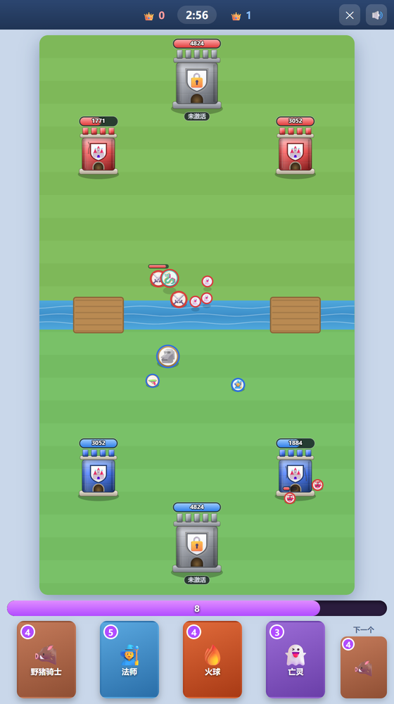

# 皇室战争纯净版 · Clash Lite

> 一个纯前端实现的《皇室战争》复刻：40+ 张卡牌、四档 AI、单文件、打开浏览器就能玩。
> 无等压 · 无觉醒 · 无精英 · 无抽卡。



## 特性

- **40+ 张卡牌**：部队、法术、建筑全都有，数值按 11 级标准逐张校准，并且还在持续补充新卡
- **完整机制**：护盾、连锁闪电、击退、眩晕、减速、狂暴、召唤、亡语、钻地、滚木/滚筒、飞桶、法术分波……
- **四档 AI**：简单 / 普通 / 困难 / 专家，会算圣水、会分路防守、会抓反打时机
- **零依赖**：一个 `index.html` + 音频素材，没有构建步骤、没有 npm、没有后端
- **即开即玩**：桌面和手机浏览器都能玩，支持触屏拖放

## 怎么玩

1. 拖动手牌到**己方半场**（推掉一座公主塔后，那一侧可以放到对面半场）
2. 圣水每秒回复 1 点，上限 10 点；卡牌左上角是费用
3. 3 分钟内推掉更多皇家塔就赢；先推掉国王塔直接获胜
4. 时间到平局则进入加时，谁先推掉一座塔谁赢

## 本地运行

**方式一：直接打开**

双击 `index.html` 即可。`file://` 下音频会自动走 `<audio>` 兜底，声音正常。

**方式二：起个本地服务器**（推荐，音频加载更稳）

```bash
# 项目根目录下
python -m http.server 8000
# 然后打开 http://localhost:8000
```

## 发布到 GitHub Pages

```bash
# 1. 在项目根目录初始化仓库
git init
git add .
git commit -m "feat: 皇室战争纯净版"

# 2. 在 GitHub 上新建一个空仓库（不要勾选 README），然后：
git branch -M main
git remote add origin https://github.com/<你的用户名>/<仓库名>.git
git push -u origin main
```

推送完成后，在仓库页面进入 **Settings → Pages**：

- **Source** 选 `Deploy from a branch`
- **Branch** 选 `main`，目录选 `/ (root)`
- 保存，等 1~2 分钟

访问 `https://<你的用户名>.github.io/<仓库名>/` 就能在线玩了。

> 说明：音频是通过 `fetch()` 加载的，必须走 `http(s)` 协议，所以**一定要用 Pages（或任意静态托管）**，不要直接分享 `file://` 路径给别人。

## 目录结构

```
.
├── index.html      # 全部逻辑：渲染、战斗、AI、UI（单文件）
├── music/          # 4 首 BGM：菜单 / 卡组 / 对战 / 加时
├── sfx/            # 22 个音效
├── screenshot.png
└── README.md
```

## 技术说明

- 原生 Canvas 2D 渲染，60 FPS，无任何框架
- 游戏坐标固定 800×1422，按容器等比缩放，手机/桌面同一套逻辑
- 音频用 Web Audio API（`decodeAudioData` + `AudioBufferSourceNode`），失败时自动降级到 `<audio>`
- 所有数值集中在 `CARDS` 常量里，改一个字段就能调平衡

## 版权

本项目仅用于学习与前端技术交流，与 Supercell 无关。《皇室战争》(Clash Royale) 的玩法、卡牌名称与美术风格版权归 Supercell 所有，请勿用于商业用途。
